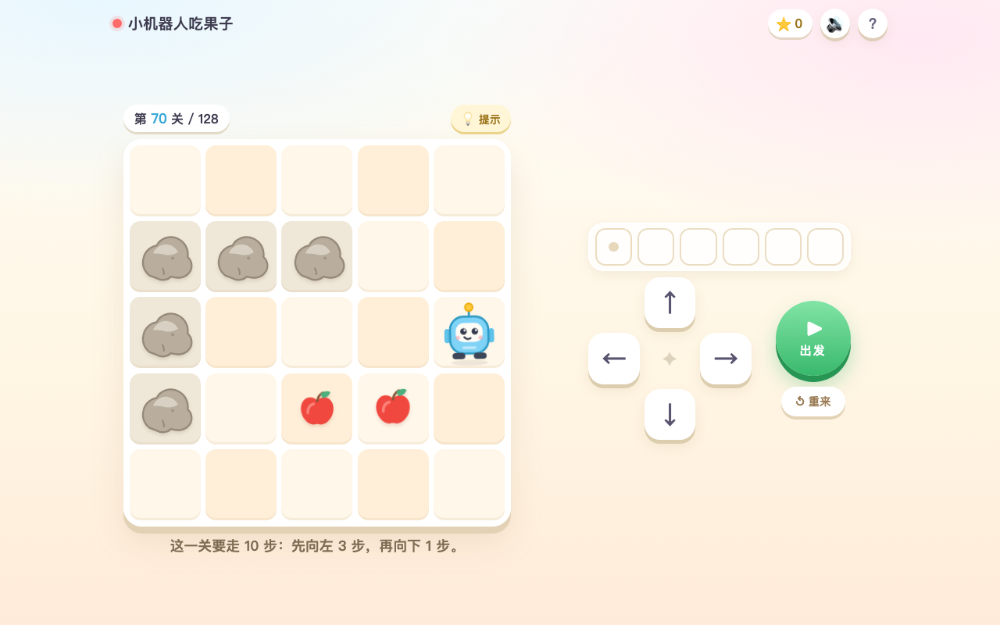

# 小机器人吃果子

给 6 岁左右小朋友的编程启蒙小游戏：**128 关，8 章，每章 16 关**。
单个 HTML 文件，不联网、不需要安装，双击就能玩。

> 这个文件夹是一个**独立项目**，只依赖本目录内的文件；
> 不会影响同一工作区里的其他网页（例如五笔字根练习）。



## 打开方式

- 双击 `index.html`（推荐 Chrome / Edge / Safari）。
- 想用平板玩：把文件放到平板能打开的位置，或用局域网起一个静态服务：
  ```bash
  cd 这个目录
  python3 -m http.server 8000
  # 平板浏览器访问 http://电脑的局域网IP:8000
  ```

第一次点屏幕之后才会有声音（浏览器的自动播放限制）。进度存在浏览器本地，换设备不会同步。

## 怎么玩

1. 点下面的 **↑ ↓ ← →**，把想走的步子排进上面的格子里。
2. 点绿色 **出发**，小机器人一步一步照着走。
3. 点一下格子里的箭头，就能删掉那一步。
4. 吃掉本关所有果子（或星星）就过关，右上角的 ★ 是你的总星星数。

## 128 关的节奏

| 章 | 名称 | 关卡 | 新增的东西 |
| --- | --- | --- | --- |
| 1 | 出发 | 1–16 | 直线、简单拐弯，2–5 步 |
| 2 | 拐个弯 | 17–32 | 连续转向，4–7 步 |
| 3 | 石头路 | 33–48 | 出现挡路的石头 |
| 4 | 双份果子 | 49–64 | 一关两颗果子，要全部吃到 |
| 5 | 小小迷宫 | 65–80 | 更多石头 + 两颗果子 |
| 6 | 星星雨 | 81–96 | 三颗星星 |
| 7 | 绕远路 | 97–112 | 更长的路线，10–16 步 |
| 8 | 终章挑战 | 113–128 | 最长 20 步，石头 + 三颗星 |

每章 16 关，通关一章会有单独的庆祝页。所有关卡都可以在「选一关」里自由选择，不强制按顺序解锁——小朋友想跳着玩也没关系。

## 设计上的几个取舍（给家长 / 老师）

- **不识字也能玩**：全靠图形、颜色、音效和中文语音提示，没有必须阅读的文本。
- **没有失败惩罚**：撞墙只会晃一晃、温柔提示，不扣分、不计时、不结束，随时重来。
- **即时反馈**：每走一步都有动画和音效；吃到最后一颗果子立刻过关撒彩带。
- **只练三件事**：顺序（先走后走）、方向（上下左右）、调试（删掉错的那一步）。
- **提示是脚手架**：卡住时点「💡 提示」，会高亮下一步该按哪个方向，而不是直接给答案。
- **长程序会自动提速**：超过 10 步后每步 270ms，避免等待太久。
- **按钮够大**：方向键最小 42px，常规 54–76px，适合小朋友的手指。

## 想自己改关卡？

打开 `index.html`，找到 `const LEVELS = [...]`（128 条，每条一行）。每关是这样一条：

```js
{ start: [4, 3], fruits: [[2, 3]], walls: [], solution: ['U', 'U'],
  tip: '向上 2 步，果子就在那里，出发吧！' }
```

- 棋盘固定 5×5，坐标是 `[行, 列]`，从 0 开始，左上角是 `[0, 0]`。
- `start` 起点，`fruits` 果子位置，`walls` 石头位置（不可通过）。
- `solution` 是一组标准解，**提示按钮靠它工作**，改关卡记得同步改。
- `tip` 是关卡提示语，会显示在棋盘下方并朗读出来。
- 想用星星代替苹果：在这一关里加 `fruit: 'star'`。

程序最长 24 步（`MAX_PROGRAM`）。章节名在 `CHAPTERS` 里，每 16 关一章。

## 关卡生成器

`tools/generate-levels.py` 就是生成这 128 关的脚本：随机游走生成路线 → 在路线上放果子 → 在路线外放石头 → 校验每一关的解法都合法。固定随机种子，所以结果可复现。

```bash
python3 tools/generate-levels.py   # 输出 levels.json
```

改完生成器后，需要把新的 `LEVELS` 数据同步回 `index.html`。

## 兼容性

- Chrome / Edge / Safari 桌面版与移动版。
- 横屏、竖屏、平板、手机都做了布局适配，矮屏幕（横屏手机）会切换成左右两栏。
- 支持键盘：方向键排步子，回车出发，退格删一步，R 重来。
