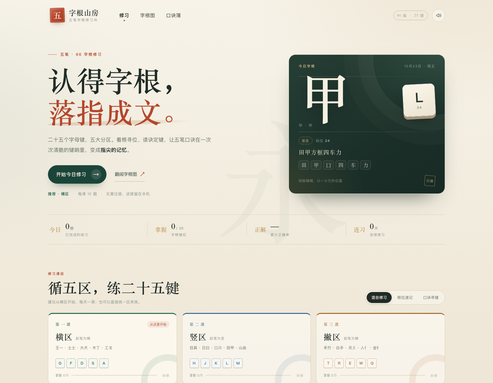
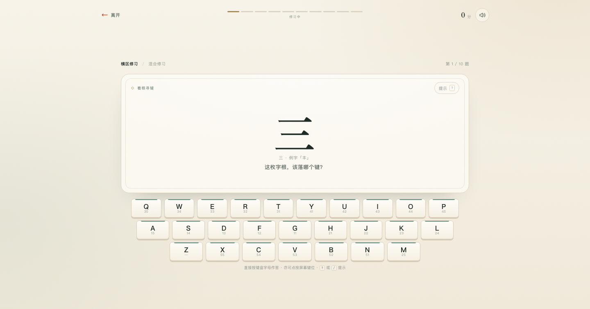
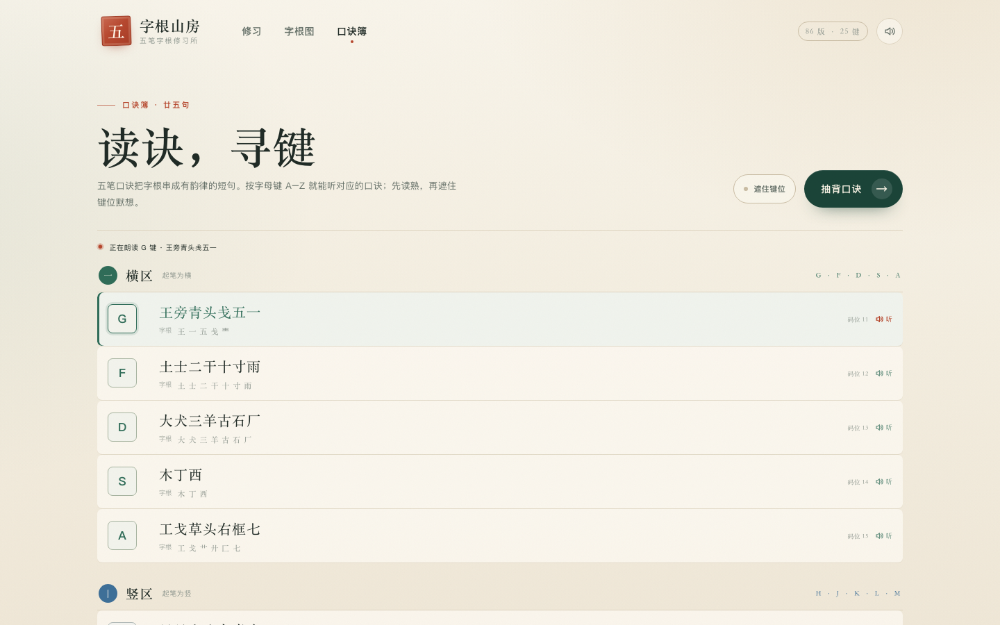

# 字根山房 · 五笔字根修习

一款用来练习 **五笔字型 86 版字根、键位与口诀** 的网页小游戏。单个 HTML 文件，不联网、不需要安装，双击就能玩。







## 打开方式

- 双击 `index.html`（推荐新版 Chrome / Edge / Safari）。
- 如果浏览器不允许本地网页保存进度，可以在目录里起一个静态服务：
  ```bash
  cd 这个目录
  python3 -m http.server 8000
  # 浏览器访问 http://localhost:8000
  ```
- 音效在第一次点击或按键后才会开始（浏览器的自动播放限制）。

## 怎么玩

游戏把 25 个五笔字根键按起笔分成横、竖、撇、捺、折五区，每区 5 键，每课 10 题。

1. 在首页选择修习方式：
   - **混合修习**：字根寻位与口诀寻键交替出现。
   - **根位速记**：屏幕给出一个字根，按出它所在的字母键。
   - **口诀寻键**：屏幕给出一句字根口诀，按出它指向的字母键。
2. 选一区开始，也可以直接做终课「综合修习」。
3. 用物理键盘按 **A–Z** 作答；手机或平板可以直接点屏幕上的键位。
4. 答错不扣命，会停下来展示正确键位、完整口诀和这枚键上的字根，按 `Enter` 继续。
5. 每题按连对累计得分，课末有正确率、最长连对和 S/A/B/C 评级。键位练熟后会显示为「已稳」。

### 快捷键

| 按键 | 作用 |
| --- | --- |
| `A`–`Z` | 游戏中作答；口诀簿中朗读对应口诀（`Z` 不属于五笔字根键） |
| `?` 或 `/` | 显示本题提示（会中断连对，答对得 5 分） |
| `Enter` / `Space` | 反馈页继续下一题 |
| `Esc` | 离开当前修习 |

## 页面内容

- **修习**：今日字根、五区课目、综合修习，以及今日题量 / 掌握键数 / 累计正确率 / 连续修习天数。
- **字根图**：25 键完整速查，包含每一键的口诀、字根与例字；按分区筛选，点键位可看详情并单独专练这一键。
- **口诀簿**：25 句口诀集中翻阅。按对应字母键（如 `G`）会用浏览器中文语音念出这一键的口诀；未遮键位时点击任意一句也能朗读。点「遮住键位」后可逐句翻看、默想。页内还能直接开始「口诀抽背」。
- **进度**：保存在浏览器 `localStorage`，键位掌握度、课目星级和练习统计都会保留。页脚「清除记录」可重置。

## 设计上的几个取舍

- **只练「认根」和「找键」**：不做整字拆分编码，避免把简码、识别码等进阶规则混进入门练习。
- **错误即教学**：答错时展示完整键位、口诀和根表，不设生命值，不催促。
- **两种输入都支持**：物理键盘培养指法，屏幕键位保证手机可用。
- **口诀可以听**：口诀簿里按字母键，就用系统中文语音念出对应口诀；语音依赖浏览器与系统的中文语音包。
- **提示有代价但不惩罚**：提示会让本题得分减半并中断连对，仍算一次有效练习。
- **离线优先**：没有字体、图片、音频等外部请求；音效由 Web Audio 实时合成，口诀朗读使用浏览器内置的语音合成。
- **无障碍与适配**：支持键盘操作、减少动态效果偏好、桌面 / 平板 / 手机布局与安全区。

## 想自己改内容？

打开 `index.html`：

- `ZONES` 定义五区、每区键位和文案。
- `KEYS` 是 25 键的数据，每键包含 `code`（区位码）、`mnemonic`（口诀）和 `roots`（字根、名称、例字）。
- `startSession` 里的 `buildQuestions(keys, mode, 10)` 控制每课题数。
- 游戏存档键为 `zigen-shanfang-v1`；改版数据结构后可调整 `defaultSave()`。
- 主色变量在 `:root` 的 `--z1`～`--z5`，以及 `--jade`、`--cinnabar`、`--gold`。

## 兼容性

- 已在桌面 1440 / 1024、平板 768、手机 390 / 320 宽度下检查过布局，无横向溢出。
- 使用 `dialog`、`color-mix()`、`dvh` 等现代前端特性，建议使用较新的浏览器。
- 口诀朗读使用浏览器 `speechSynthesis`，需要系统装有中文语音包；若系统没有可用中文语音，会提示朗读失败。右上角声音按钮同时控制音效与朗读。
- 所有内容与进度均留在本机，不收集任何数据。

## 字根资料

86 版字根、口诀与例字按公开资料整理并交叉核对，可参考：

- [五笔打字教程 · 熟悉五笔字型字根（w3cschool）](https://m.w3cschool.cn/wbdzjc/ychptg.html)
- [从零开始学五笔 · 捺区字根（博客园）](https://www.cnblogs.com/PeterJXL/p/18502649)
- [从零开始学五笔 · 折区字根（博客园）](https://www.cnblogs.com/PeterJXL/p/18502749)

不同教材流传的口诀版本会略有差异，本页采用常见短句版本。
